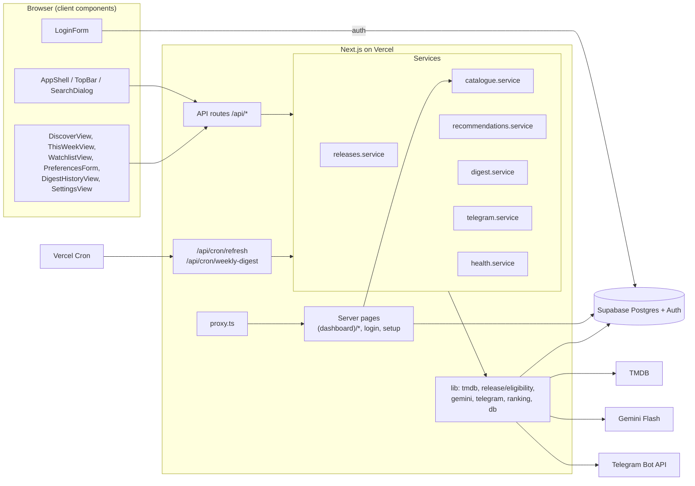
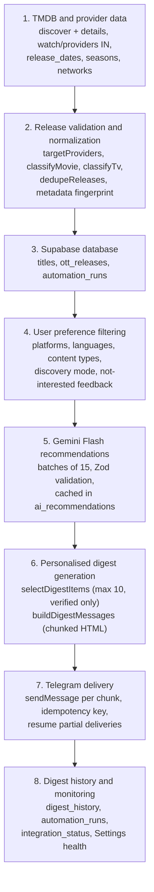

# Components Map
n> **PDF version:** [docs/ott-release-radar-components-map.pdf](docs/ott-release-radar-components-map.pdf) (page 1: step-by-step map; page 2: step details). Regenerate with `node docs/components-map/build.mjs`, then print the HTML to PDF.

How the frontend components, API routes, services, database tables and external services of OTT Release Radar fit together. For setup and behaviour details see [README.md](./README.md).

Conventions used below:

- **Server** = React Server Component or server code; **Client** = `"use client"` component.
- Client components never call TMDB, Gemini or Telegram directly, and never hold server keys. They call this app's own API routes through `api()` in `src/lib/client-api.ts` (which redirects to `/login` on a 401). The only direct Supabase use in the browser is authentication in `LoginForm`.
- Server pages read Supabase through the user-scoped client (RLS applies).

---

## Architecture

## End-to-end flow

| Step | Code | Tables | External |
| --- | --- | --- | --- |
| 1. Fetch | `src/lib/tmdb/client.ts`, `src/lib/tmdb/adapter.ts` (`TmdbReleaseAdapter.fetchWindow`) | — | TMDB |
| 2. Validate and normalise | `src/lib/release/eligibility.ts`, `normalize()` in adapter, `src/lib/fingerprint.ts` | — | — |
| 3. Store | `refreshReleases` in `src/services/releases.service.ts`, `upsertTitles` / `upsertReleases` in `src/lib/db/catalogue.ts`, `startRun` / `finishRun` in `src/lib/db/ops.ts` | `titles`, `ott_releases`, `automation_runs`, `integration_status`, reads `user_preferences.preferred_languages` | — |
| 4. Filter | `getCatalogue` / `decorate` in `catalogue.service.ts`, `src/lib/ranking/signals.ts`, `filters.ts` | `ott_releases`, `titles`, `watchlist`, `viewing_feedback`, `ai_recommendations` | — |
| 5. Recommend | `ensureRecommendations` in `recommendations.service.ts`, `src/lib/gemini/*` | `ai_recommendations`, `viewing_feedback`, `integration_status` | Gemini |
| 6. Build digest | `buildDigest` in `digest.service.ts`, `src/lib/ranking/digest-select.ts`, `src/lib/telegram/format.ts` | `digest_history` | — |
| 7. Deliver | `deliver` / `deliverWeekly` / `sendTestDigest` / `runWeeklyDigest` in `digest.service.ts`, `src/lib/telegram/client.ts` | `digest_history`, `user_preferences`, `automation_runs`, `integration_status` | Telegram |
| 8. Monitor | `integrationHealth` in `health.service.ts`, `listDigestHistory`, `latestRuns`, `lastSuccessfulRun` | `digest_history`, `automation_runs`, `integration_status` | TMDB, Gemini, Telegram (health pings) |

---

## Pages and routes

| Route | Page file | Main component | Data loaded on the server |
| --- | --- | --- | --- |
| `/` | `src/app/page.tsx` | — | Redirects to `/discover` |
| `/login` | `src/app/(auth)/login/page.tsx` | `LoginForm` | None (redirects to `/setup` if Supabase is unconfigured) |
| `/setup` | `src/app/setup/page.tsx` | (inline) | `isConfigured()` per env group |
| `/discover` | `src/app/(dashboard)/discover/page.tsx` | `DiscoverView` | `getPreferences`, `getCatalogue` |
| `/this-week` | `src/app/(dashboard)/this-week/page.tsx` | `ThisWeekView` | `getPreferences`, `getCatalogue` |
| `/title/[id]` | `src/app/(dashboard)/title/[id]/page.tsx` | (inline) + `TitleActions` | `getPreferences`, `getTitleDetail` |
| `/watchlist` | `src/app/(dashboard)/watchlist/page.tsx` | `WatchlistView` | `getPreferences`, `getWatchlistItems` |
| `/preferences` | `src/app/(dashboard)/preferences/page.tsx` | `PreferencesForm` | `getPreferences` |
| `/digest-history` | `src/app/(dashboard)/digest-history/page.tsx` | `DigestHistoryView` | `listDigestHistory`, `lastSuccessfulDelivery` |
| `/settings` | `src/app/(dashboard)/settings/page.tsx` | `SettingsView` | `getPreferences`, `getProfile`, `latestRuns`, `lastSuccessfulRun`, `lastSuccessfulDelivery`, `nextDigestRun` |
| All dashboard routes | `src/app/(dashboard)/layout.tsx` | `AppShell` | `requirePageUser`, `getPreferences`, `getProfile`, refresh run status, last delivery, next digest run |

`src/app/(dashboard)/loading.tsx` (skeletons) and `error.tsx` (retry screen) apply to all dashboard routes.

---

## Frontend components

### Layout and shared (all dashboard pages)

| Component | File | Type | Responsibility | Parent | Data dependencies | API endpoints | Tables (via API/page) | External services |
| --- | --- | --- | --- | --- | --- | --- | --- | --- |
| **AppShell** | `src/components/layout/AppShell.tsx` | Client | Collapsible sidebar with `NAV_ITEMS` (collapse state in `localStorage`), wraps page content and renders `TopBar`. | `(dashboard)/layout.tsx` | `user` (email, display name), `ShellStatus` from the layout | — | `profiles`, `user_preferences`, `automation_runs`, `digest_history` (read by layout) | — |
| **TopBar** | `src/components/layout/TopBar.tsx` | Client | Mobile nav sheet, search button (⌘K), status popover (today, window, last sync, Telegram, digest on/off, next run, last delivery), user menu with sign-out. | `AppShell` | `ShellStatus`, `user` | `POST /auth/signout` (form) | as above | — |
| **SearchDialog** | `src/components/layout/SearchDialog.tsx` | Client | Command-palette title search over the stored catalogue; links to `/title/[id]`. | `TopBar` | Query text | `GET /api/search?q=` | `titles`, `ott_releases` | — |
| **Logo / LogoMark** | `src/components/common/Logo.tsx` | Server-safe | Brand mark and wordmark (collapsed variant). | `AppShell`, `TopBar`, login and setup pages | — | — | — | — |
| **Poster** | `src/components/releases/Poster.tsx` | Client | `next/image` from `image.tmdb.org` with a fallback tile if the path is missing or fails to load. | `ReleaseCard`, `ReleaseRow`, `Hero`, `PickNextWatch`, title page | `posterPath` / `backdropPath` | — | `titles` | TMDB image CDN |
| **Badges**: `PlatformBadge`, `VerdictBadge`, `ReleaseDateLabel` | `src/components/releases/badges.tsx` | Server-safe | Platform chip, watch / maybe / skip chip, release-date label with verified / unverified status and date type. | Cards, `Hero`, `PickNextWatch`, `TitleActions`, `DigestPreviewDialog`, title page | `ProviderKey`, `Verdict`, `OttRelease` | — | `ott_releases`, `ai_recommendations` | — |

### Authentication and setup

| Component | File | Type | Responsibility | Parent | Data dependencies | API endpoints | Tables | External services |
| --- | --- | --- | --- | --- | --- | --- | --- | --- |
| **LoginForm** | `src/components/common/LoginForm.tsx` | Client | Sign in with password, create account (email confirmation), or send a magic link. Redirects via `/auth/callback?next=`. | `/login` page | `next` path | Supabase Auth directly (`signInWithPassword`, `signUp`, `signInWithOtp`); `GET /auth/callback` | `auth.users` (trigger creates `profiles`, `user_preferences`) | Supabase Auth (email) |
| **Setup page** | `src/app/setup/page.tsx` | Server | Lists env groups (Supabase, TMDB, Gemini, Telegram, Cron) as Set / Missing. Shows variable names only, never values. | Root layout | `isConfigured()` | — | — | — |

### Discover (`/discover`)

| Component | File | Type | Responsibility | Parent | Data dependencies | API endpoints | Tables | External services |
| --- | --- | --- | --- | --- | --- | --- | --- | --- |
| **DiscoverView** | `src/components/releases/DiscoverView.tsx` | Client | Main dashboard: sync bar, hero pick, stats tiles, filters, card grid, "Pick My Next Watch", digest preview button. Filters default to the user's preferences, verified only. | Discover page | `initialItems: CatalogueItem[]`, `prefs`, `watchlistCount`, last sync status; client state via `useCatalogue` | `POST /api/releases/refresh`, `POST /api/recommendations` (through `useCatalogue`) | `titles`, `ott_releases`, `ai_recommendations`, `watchlist`, `automation_runs` | TMDB, Gemini (server-side, on button press) |
| **SyncBar** | `src/components/releases/SyncBar.tsx` | Client | Last sync time / failure warning, **Refresh Releases** button, **Get AI verdicts (n)** button and AI error text. | `DiscoverView`, `ThisWeekView` | `lastSyncedAt`, `refreshState`, `aiState`, `aiError`, unscored count | (callbacks to `useCatalogue`) `POST /api/releases/refresh`, `POST /api/recommendations` | `automation_runs`, `ai_recommendations` | TMDB, Gemini |
| **Hero** | `src/components/releases/Hero.tsx` | Client | Featured title (best match under default filters): backdrop, platforms, release label, `MatchScore`, verdict, watchlist button. | `DiscoverView` | `CatalogueItem`, `prefs`, `mood` | `POST/DELETE /api/watchlist` (via `WatchlistControl`) | `titles`, `ott_releases`, `ai_recommendations`, `watchlist` | TMDB images |
| **ReleaseCard / ReleaseRow** | `src/components/releases/ReleaseCard.tsx` | Client | Grid card and compact list row for one title: poster, platforms, verdict, match score, release label, length, watchlist control, link to detail. | `DiscoverView`, `ThisWeekView` (card and row), `WatchlistView` (row) | `CatalogueItem`, `prefs`, `mood`, `href` | `POST/DELETE /api/watchlist` (via `WatchlistControl`) | `titles`, `ott_releases`, `ai_recommendations`, `watchlist` | TMDB images |
| **MatchScore / WhyThisMatches** | `src/components/releases/MatchScore.tsx` | Client | Shows the AI match score (or "not scored"), with a popover explaining genre, language, platform and mood alignment plus metadata confidence from `matchSignals()`. Never shows a rule score as an AI score. | `ReleaseCard`, `ReleaseRow`, `Hero`, `PickNextWatch`, `TitleActions` | `CatalogueItem.recommendation`, `prefs`, `mood` | — | `ai_recommendations` | — |
| **PickNextWatch** | `src/components/releases/PickNextWatch.tsx` | Client | Dialog with a weighted-random pick (`weightedPick`) from the currently filtered list, avoiding skip and not-interested titles; "Pick again" and add to watchlist. Also used as "Surprise me". | `DiscoverView` | Filtered `items`, `prefs`, `mood` | `POST/DELETE /api/watchlist` | `watchlist` | — |
| **DigestPreviewDialog** | `src/components/digest/DigestPreviewDialog.tsx` | Client | "Preview My Friday Digest": builds the digest on the server without sending, shows selected titles with verdicts and the exact Telegram messages. | `DiscoverView`, `DigestHistoryView` | Response from preview endpoint | `POST /api/digest/preview` | `titles`, `ott_releases`, `ai_recommendations`, `digest_history` (kind `preview`) | Gemini (for missing verdicts) |

### Filters and controls (`src/components/filters/controls.tsx`)

All are Client components with no API calls; they change local or URL filter state that is applied by `applyFilters()` in `src/lib/ranking/filters.ts`.

| Control | Responsibility | Used by |
| --- | --- | --- |
| **PlatformToggles** | Toggle Netflix / Prime Video / Hotstar. | `DiscoverView`, `ThisWeekView`, `PreferencesForm` |
| **MultiSelect** | Searchable multi-select popover (genres, languages) with optional apply footer. | `DiscoverView`, `ThisWeekView` |
| **QuickFilterControl** | All / Best matches / Movies / Series. | `DiscoverView` |
| **WatchTimeSelect** | Any, under 30/60/90 minutes (episode runtime for series), movie night 90+, binge-worthy, surprise. | `DiscoverView` |
| **MoodSelect** | Mood filter (mind-bending, edge-of-seat, feel-good, etc.); also sent to Gemini when generating verdicts on Discover. | `DiscoverView` |
| **HiddenGemToggle** | Fewer than 250 TMDB votes and below-median popularity. | `DiscoverView` |

### This Week (`/this-week`)

| Component | File | Type | Responsibility | Parent | Data dependencies | API endpoints | Tables | External services |
| --- | --- | --- | --- | --- | --- | --- | --- | --- |
| **ThisWeekView** | `src/components/releases/ThisWeekView.tsx` | Client | The seven-day window (never widened) with filters stored in the URL (`p`, `g`, `l`, `type`, `v`, `q`, `sort`, `view`, `unverified`, `n`), grid/list toggle and "show more" paging. | This Week page (in `Suspense`) | `initialItems`, `prefs`, `window`, sync status; `useSearchParams` | `POST /api/releases/refresh`, `POST /api/recommendations`, `POST/DELETE /api/watchlist` | `titles`, `ott_releases`, `ai_recommendations`, `watchlist`, `automation_runs` | TMDB, Gemini (server-side, on button press) |

### Title detail (`/title/[id]`)

| Component | File | Type | Responsibility | Parent | Data dependencies | API endpoints | Tables | External services |
| --- | --- | --- | --- | --- | --- | --- | --- | --- |
| **Title page** | `src/app/(dashboard)/title/[id]/page.tsx` | Server | Backdrop, poster, overview (or no-synopsis notice), AI recommendation panel, details, per-platform release events with verified / unverified status and safe TMDB link. | Dashboard layout | `getTitleDetail` | — | `titles`, `ott_releases`, `ai_recommendations`, `watchlist` | TMDB images and TMDB links |
| **TitleActions** | `src/components/releases/TitleActions.tsx` | Client | Match score, release label and watchlist button for the title. | Title page | `CatalogueItem`, `prefs` | `POST/DELETE /api/watchlist` | `watchlist`, `viewing_feedback` | — |

### Watchlist (`/watchlist`)

| Component | File | Type | Responsibility | Parent | Data dependencies | API endpoints | Tables | External services |
| --- | --- | --- | --- | --- | --- | --- | --- | --- |
| **WatchlistView** | `src/components/watchlist/WatchlistView.tsx` | Client | Saved titles (including older releases) filtered by status and platform, with counts; works from the database only. | Watchlist page | `initialItems` from `getWatchlistItems`, `prefs` | `POST/DELETE /api/watchlist` (via rows) | `watchlist`, `titles`, `ott_releases`, `ai_recommendations` | — |
| **WatchlistControl** | `src/components/watchlist/WatchlistControl.tsx` | Client | Icon or button dropdown to set status (want to watch, watching, watched, not interested) or remove. "Not interested" also records feedback. | `ReleaseCard`, `ReleaseRow`, `Hero`, `PickNextWatch`, `TitleActions` | `titleId`, current `status` | `POST /api/watchlist`, `DELETE /api/watchlist` | `watchlist`, `viewing_feedback` | — |

### Preferences (`/preferences`)

| Component | File | Type | Responsibility | Parent | Data dependencies | API endpoints | Tables | External services |
| --- | --- | --- | --- | --- | --- | --- | --- | --- |
| **PreferencesForm** | `src/components/preferences/PreferencesForm.tsx` | Client | Edit genres, languages, platforms, personalisation strength, content types, runtime, dubbed, popularity, genre exploration, default mood, use of feedback; reset to defaults; save. | Preferences page | `initial: Preferences` | `PUT /api/preferences` | `user_preferences` (only granted columns) | — |

### Digest history (`/digest-history`)

| Component | File | Type | Responsibility | Parent | Data dependencies | API endpoints | Tables | External services |
| --- | --- | --- | --- | --- | --- | --- | --- | --- |
| **DigestHistoryView** | `src/components/digest/DigestHistoryView.tsx` | Client | List of preview / test / weekly digests with status, period, title counts, errors; dialog showing the exact messages; preview button. | Digest History page | `history: DigestRecord[]`, `lastDelivery` | `POST /api/digest/preview` (via `DigestPreviewDialog`) | `digest_history` | — |
| **TelegramMessage / TelegramBubble** | `src/components/digest/TelegramMessage.tsx` | Server-safe | Renders the app's own Telegram HTML (`<b>`, `<i>`, `<a>` only) as React elements without `dangerouslySetInnerHTML`, inside a Telegram-style bubble. | `DigestPreviewDialog`, `DigestHistoryView` | Message HTML string | — | `digest_history.message_chunks` | — |

### Settings (`/settings`)

| Component | File | Type | Responsibility | Parent | Data dependencies | API endpoints | Tables | External services |
| --- | --- | --- | --- | --- | --- | --- | --- | --- |
| **SettingsView** | `src/components/settings/SettingsView.tsx` | Client | Profile (display name), preference summary, weekly digest on/off and delivery day, Telegram card, integration health with re-check, automation status (last refresh, last digest run, next run, last delivery). | Settings page | `email`, `displayName`, `prefs`, `automation` from the page; health fetched on mount | `GET /api/health`, `GET /api/health?force=1`, `PUT /api/preferences` (`digestEnabled`, `digestDay`), `PATCH /api/profile` | `profiles`, `user_preferences`, `integration_status`, `automation_runs`, `digest_history` | TMDB, Gemini, Telegram (health pings via server) |
| **TelegramCard** (inside `SettingsView.tsx`) | same file | Client | Four-step link flow (get link → Start in Telegram → verify → connected), send test digest, disconnect. | `SettingsView` | Connection state, Telegram health | `POST /api/telegram/connect`, `POST /api/telegram/verify`, `POST /api/telegram/test`, `DELETE /api/telegram/connect` | `telegram_link_codes`, `user_preferences` (telegram columns, server-written), `digest_history` | Telegram |

### Client hook

| Hook | File | Responsibility | API endpoints |
| --- | --- | --- | --- |
| `useCatalogue` | `src/hooks/useCatalogue.ts` | Holds the item list, optimistic watchlist status updates, manual refresh (then `router.refresh()`), and AI generation with a single in-flight guard. | `POST /api/releases/refresh`, `POST /api/recommendations` |

---

## API routes → services → tables → external services

All user routes call `requireUser()` (Supabase JWT verified server-side) and return errors through `apiError()` (401 / 400 / 503 / 500). Cron routes require `Authorization: Bearer $CRON_SECRET`.

| Route | Method(s) | Auth | Service / lib | Tables | External |
| --- | --- | --- | --- | --- | --- |
| `/api/releases` | GET | User | `getCatalogue` | `user_preferences`, `ott_releases`, `titles`, `ai_recommendations`, `watchlist`, `automation_runs` | — |
| `/api/releases/refresh` | POST | User (one run per 5 min app-wide) | `refreshReleases` (manual) | `titles`, `ott_releases`, `automation_runs`, `integration_status`, `user_preferences` | TMDB |
| `/api/recommendations` | POST | User (15 s per-instance throttle) | `getCatalogue`, `ensureRecommendations` | `ai_recommendations`, `viewing_feedback`, `integration_status` + catalogue tables | Gemini |
| `/api/search` | GET | User | `searchTitles` | `titles`, `ott_releases` | — |
| `/api/watchlist` | GET, POST, DELETE | User | `getWatchlistItems`, `upsertWatchlist`, `removeWatchlist`, `addFeedback`, `clearFeedback` | `watchlist`, `viewing_feedback`, `titles`, `ott_releases`, `ai_recommendations` | — |
| `/api/preferences` | GET, PUT | User (user-scoped client; column grants) | `getPreferences`, `updatePreferences` | `user_preferences` | — |
| `/api/profile` | PATCH | User | `updateProfile` | `profiles` | — |
| `/api/digest/preview` | POST | User | `previewDigest` → `buildDigest` | `digest_history` + catalogue and recommendation tables | Gemini |
| `/api/digest/history` | GET | User | `listDigestHistory` | `digest_history` | — |
| `/api/telegram/connect` | GET, POST, DELETE | User | `telegramStatus`, `startTelegramConnection`, `disconnectTelegram` | `telegram_link_codes`, `user_preferences` | Telegram (`getMe`) |
| `/api/telegram/verify` | POST | User | `verifyTelegramConnection` | `telegram_link_codes`, `user_preferences`, `integration_status` | Telegram (`getUpdates`, `sendMessage`) |
| `/api/telegram/test` | POST | User (one per minute) | `sendTestDigest` → `buildDigest`, `deliver` | `digest_history`, `integration_status` + catalogue tables | Gemini, Telegram |
| `/api/health` | GET | User | `integrationHealth` (cached 5 min unless `force=1`) | `integration_status` | TMDB, Gemini, Telegram |
| `/api/cron/refresh` | GET | `CRON_SECRET` | `refreshReleases` (cron, one per IST day) | `titles`, `ott_releases`, `automation_runs`, `integration_status` | TMDB |
| `/api/cron/weekly-digest` | GET | `CRON_SECRET` | `runWeeklyDigest` → `refreshReleases`, `listDigestRecipients`, `deliverWeekly` | all digest, catalogue and ops tables | TMDB, Gemini, Telegram |
| `/auth/callback` | GET | Public | Supabase `exchangeCodeForSession` / `verifyOtp` | `auth.*` | Supabase Auth |
| `/auth/signout` | POST | Session | Supabase `signOut` | `auth.*` | Supabase Auth |

## Server services

| Service | File | Responsibility | Lib modules | Tables | External |
| --- | --- | --- | --- | --- | --- |
| Releases | `src/services/releases.service.ts` | Refresh pipeline: IST window → adapter → upsert → run log. Idempotent; never deletes data on failure. | `tmdb/adapter`, `release/eligibility`, `db/catalogue`, `db/ops`, `dates/ist` | `titles`, `ott_releases`, `automation_runs`, `integration_status`, `user_preferences` (languages) | TMDB |
| Catalogue | `src/services/catalogue.service.ts` | Read-only catalogue for a user: releases in window, primary release, verified flag, cached recommendations (if fingerprints match), watchlist status; title detail; watchlist items; preference fingerprint. | `db/catalogue`, `db/users`, `db/ops`, `fingerprint` | `ott_releases`, `titles`, `ai_recommendations`, `watchlist`, `automation_runs` | — |
| Recommendations | `src/services/recommendations.service.ts` | Generate missing Gemini verdicts for relevant titles, save them, record integration status, fail gracefully. | `gemini/*`, `ranking/signals`, `db/users`, `db/ops` | `ai_recommendations`, `viewing_feedback`, `integration_status` | Gemini |
| Digest | `src/services/digest.service.ts` | Build digest, preview, test send, weekly per-user delivery with idempotency and resume, scheduled run across recipients. | `ranking/digest-select`, `telegram/*`, `db/users`, `db/ops` | `digest_history`, `user_preferences`, `automation_runs`, `integration_status`, `viewing_feedback` | Gemini, Telegram (and TMDB via refresh) |
| Telegram | `src/services/telegram.service.ts` | One-time link codes, deep link, chat verification via `getUpdates`, disconnect, status. | `telegram/client`, `db/ops`, `db/users` | `telegram_link_codes`, `user_preferences`, `integration_status` | Telegram |
| Health | `src/services/health.service.ts` | Real authenticated pings per integration, cached 5 minutes. | `tmdb/client`, `gemini/client`, `telegram/client`, `db/ops`, `env` | `integration_status` | TMDB, Gemini, Telegram |

## Supporting library modules

| Module | Purpose |
| --- | --- |
| `src/lib/env.ts` | Per-integration env validation (`env()`, `isConfigured()`, `ConfigError`). |
| `src/lib/auth/session.ts`, `src/lib/auth/cron.ts` | `requireUser` / `requirePageUser`; constant-time cron bearer check. |
| `src/proxy.ts` | Session cookie refresh, redirects to `/login` or `/setup`. |
| `src/lib/supabase/server.ts`, `browser.ts` | User-scoped (RLS) client, service-role admin client, browser auth client. |
| `src/lib/db/catalogue.ts`, `users.ts`, `ops.ts`, `mappers.ts` | Typed database access and row ↔ domain mapping. |
| `src/lib/tmdb/client.ts`, `adapter.ts` | TMDB HTTP client with retries; `ReleaseSourceAdapter` implementation. |
| `src/lib/release/eligibility.ts`, `types.ts` | Release-date rules (verified / unverified / excluded) and normalised types. |
| `src/lib/gemini/client.ts`, `prompt.ts`, `schema.ts` | Batched generation, prompt with untrusted-data block, Zod validation and verdict bands. |
| `src/lib/ranking/signals.ts`, `filters.ts`, `digest-select.ts` | Match signals, metadata confidence, hidden gems, UI filters, weighted pick, digest selection. |
| `src/lib/telegram/client.ts`, `format.ts` | Bot API calls with error classification; HTML escaping, safe links, chunking. |
| `src/lib/dates/ist.ts`, `src/lib/schedule.ts` | IST window and formatting; next digest run derived from `vercel.json`. |
| `src/config/providers.ts`, `taxonomy.ts` | Platform IDs and name patterns; genres, languages, moods, discovery modes, statuses. |
