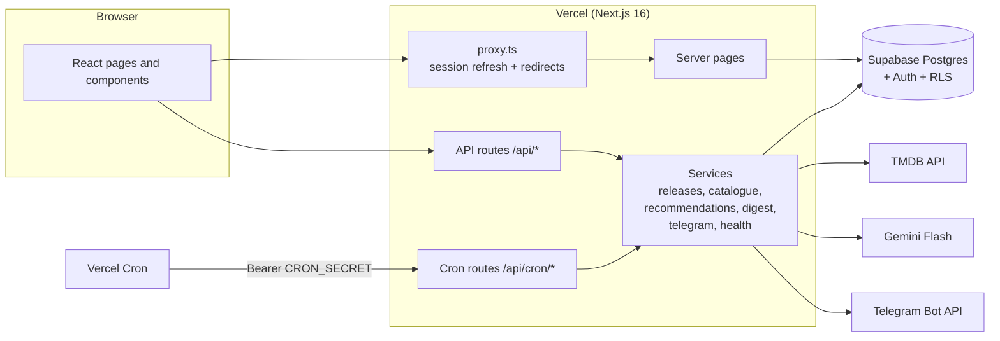
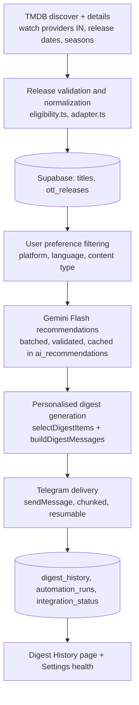

# OTT Release Radar

> Your next favourite watch, discovered automatically.

A personal web app that finds what was newly released on Netflix, Amazon Prime Video and Disney+ Hotstar in India in the last seven days, filters it to your taste, asks Google Gemini Flash for a watch / maybe / skip verdict on each title, and sends you a weekly digest on Telegram.

**Status:** the code, unit tests, type checks and build run locally. The app has **not yet been tested against real Supabase, TMDB, Gemini or Telegram services** and has **not been verified on a live Vercel deployment**, because credentials are not configured yet. Treat the deployment, Telegram and live-data sections below as setup instructions, not as confirmed behaviour. See [Integration-test strategy](#integration-test-strategy-real-external-connections).

---

## Contents

1. [Project overview](#project-overview)
2. [Problem statement](#problem-statement)
3. [Key features](#key-features)
4. [Architecture](#architecture)
5. [Technology stack](#technology-stack)
6. [Data flow](#data-flow)
7. [Release-date validation strategy](#release-date-validation-strategy)
8. [AI recommendation logic](#ai-recommendation-logic)
9. [Database schema](#database-schema)
10. [API integrations](#api-integrations)
11. [Telegram bot setup](#telegram-bot-setup)
12. [Supabase setup](#supabase-setup)
13. [Gemini setup](#gemini-setup)
14. [Environment variables](#environment-variables)
15. [Local installation](#local-installation)
16. [Database migration](#database-migration)
17. [Local testing](#local-testing)
18. [Vercel deployment](#vercel-deployment)
19. [Cron configuration](#cron-configuration)
20. [Known limitations](#known-limitations)
21. [Troubleshooting](#troubleshooting)

Component-level documentation is in [COMPONENTS_MAP.md](./COMPONENTS_MAP.md).

---

## Project overview

OTT Release Radar is a Next.js 16 (App Router) application backed by Supabase (Postgres + Auth). It:

- pulls new streaming releases for India from **TMDB** (including TMDB's JustWatch-powered watch-provider data),
- validates each release date against strict rules and stores the result in **Supabase**,
- lets each signed-in user set genre, language, platform and other preferences,
- scores titles against those preferences with **Gemini Flash** (structured JSON, validated with Zod),
- builds a personalised digest and delivers it via a **Telegram bot**,
- runs on a schedule with **Vercel Cron**.

## Problem statement

Naman subscribes to Netflix, Prime Video and Disney+ Hotstar in India. He likes thrillers, science fiction and indie dramas in Hindi, English and Tamil. Every week new titles arrive across the three platforms and he has no single place to see what is genuinely new, what suits his taste, and what to skip.

He wants a **digest on Telegram every Friday at 6 PM IST** listing the week's new releases on his platforms, filtered to his preferences, with a short AI verdict for each.

Assignment rules:

- AI recommendations must use **Gemini Flash only**.
- Release data must be **live** (fetched from a real source, not hard-coded).
- The app must be **deployed on Vercel**.

## Key features

- **Email sign-in** with Supabase Auth (password, sign-up with email confirmation, or magic link).
- **Discover** page: hero pick, summary stats, quick filters (all / best matches / movies / series), platform, genre, language, watch-time, mood and hidden-gem filters, and a weighted-random "Pick My Next Watch".
- **This Week** page: the seven-day window with URL-driven filters (platform, genre, language, type, verdict, search, sort, grid/list), with unverified releases hidden by default.
- **Title detail** page: metadata, per-platform release events with verified / unverified status, AI verdict and "Why this matches you" breakdown.
- **Watchlist** with statuses (want to watch, watching, watched, not interested). "Not interested" is also stored as feedback and lowers future recommendations and removes the title from digests.
- **Preferences**: genres, languages, platforms, content types, runtime, dubbed vs original, popular vs hidden gems, familiar vs new genres, discovery mode (stick / balanced / surprise), default mood, use of feedback.
- **AI verdicts** from Gemini Flash, cached per user, title metadata and preference profile.
- **Digest preview** (rendered as Telegram bubbles, nothing sent), **test digest** (real Telegram message), and **digest history** with the exact messages sent.
- **Settings**: digest on/off, delivery day, Telegram connection flow, integration health checks, last refresh / digest run status.
- **Global search** over the stored catalogue.
- **Setup page** (`/setup`) that lists which environment-variable groups are missing (names only, never values).

## Architecture



Key design points:

- **API keys never reach the browser.** The browser only holds the Supabase anon key (for auth). All TMDB, Gemini and Telegram calls happen in server code (`import "server-only"`).
- **Two Supabase clients.** `createUserClient()` acts as the signed-in user and goes through Row Level Security. `createAdminClient()` uses the service-role key and is used only for catalogue writes, cron jobs and server-verified operations (Gemini cache writes, digest records, Telegram linking).
- **Pages read from the database only.** Viewing Discover, This Week or the watchlist never calls TMDB or Gemini. TMDB is called by the refresh job; Gemini is called on demand ("Get AI verdicts", digest preview/test) and by the weekly digest.
- **Per-integration configuration.** `src/lib/env.ts` validates each integration separately, so a missing Telegram token does not break the catalogue.
- **`src/proxy.ts`** (Next.js 16 replacement for middleware) refreshes the Supabase session cookie and redirects signed-out visitors to `/login`, or to `/setup` if Supabase is not configured. Every page and API route verifies the user again server-side.

## Technology stack

| Layer | Technology |
| --- | --- |
| Framework | Next.js 16.4 (App Router, Turbopack), React 19.3, TypeScript 5 |
| UI | Tailwind CSS 4, shadcn/ui (Radix UI), lucide-react icons, motion, sonner toasts, cmdk |
| Database and auth | Supabase (Postgres, Auth, RLS) via `@supabase/supabase-js` and `@supabase/ssr` |
| Release data | TMDB API v3 (discover, details, release dates, watch providers) |
| AI | Google Gemini Flash via `@google/genai` (default model id `gemini-flash-latest`) |
| Messaging | Telegram Bot API (`sendMessage`, `getUpdates`, `getMe`) |
| Validation | Zod 4 |
| Hosting and scheduling | Vercel, Vercel Cron |
| Tests | Vitest 3 |

## Data flow



1. **Refresh** (`refreshReleases`, daily cron or manual button): compute the IST window `[today-6, today]`, query TMDB, validate and normalise each candidate, upsert into `titles` and `ott_releases`, log the run in `automation_runs`. A failed fetch never deletes existing data.
2. **Browse**: pages call `getCatalogue()`, which reads releases in the window from Supabase and attaches cached AI recommendations and watchlist status.
3. **Recommend** (`ensureRecommendations`): only titles on the user's platforms, in their languages and content types, and without a fresh cached recommendation are sent to Gemini.
4. **Digest** (`buildDigest`): select up to 10 verified titles for the user, format Telegram HTML messages, record in `digest_history`, send.

## Release-date validation strategy

All rules are pure functions in `src/lib/release/eligibility.ts` and are unit tested.

### Known limitation (read this first)

**TMDB has no "date added to Netflix India" (or Prime Video / Hotstar) field.** Watch-provider data says where a title streams in India *now*, without a date. The app therefore uses the closest signals TMDB does provide and labels everything else as unverified. It does not claim more certainty than the data supports.

### Rules

The window is the last seven days in India time, inclusive: `[today-6, today]` in Asia/Kolkata. **The window is never widened** to pad results; an empty week stays empty.

A title must first be **currently listed on a target platform in India** (TMDB watch providers, region `IN`, subscription / free / ads offers only; rent and buy are ignored). Providers are matched by TMDB provider ID first, with name patterns as a fallback (`src/config/providers.ts`, overridable with `PROVIDER_MAP_JSON`).

| Case | Result |
| --- | --- |
| Movie with a TMDB **India Digital release date (type 4)** inside the window | **Verified** (`in_digital_release`) |
| Movie with an India Digital date outside the window | Excluded (not new this week) |
| TV **series or season premiere** inside the window, and the show's **original network is that platform** (e.g. a Netflix original on Netflix) | **Verified** (`series_premiere` / `season_premiere`) |
| TV season premiere in the window on a platform that is not the original network | Unverified |
| Movie with no India digital date but a **global digital date** (type 4 in another country) in the window | **Unverified** (`global_digital_release`) |
| Movie with only a **primary release date** in the window | **Unverified** (`primary_release`, labelled "may be theatrical") |
| Theatrical dates | Never treated as an OTT launch |
| A new episode of an older season | Not counted |

Unverified releases are shown in the UI with a "Release date unverified" label, are **excluded from verified counts**, are hidden by default on Discover and This Week, and are **never included in digests**. Duplicate events (same platform, date type and season) are collapsed, keeping verified over unverified and the earliest date.

## AI recommendation logic

Code: `src/lib/gemini/*`, `src/services/recommendations.service.ts`.

- **Model:** Gemini Flash only. `GEMINI_MODEL` defaults to `gemini-flash-latest`.
- **Pre-filtering:** only titles that match the user's platforms, languages and content types are sent, capped at 60 per request.
- **Batching:** 15 titles per call, structured JSON output (`responseJsonSchema`), temperature 0.4, 45 s timeout. Titles that come back missing or invalid are retried once in a follow-up batch; anything still invalid is left unscored and reported, never invented.
- **Validation (Zod + rules):**
  - `title_id` must be one that was sent in the batch.
  - `match_score` must be an integer 0–100.
  - The verdict must agree with the score band: `watch` 60–100, `maybe` 35–79, `skip` 0–54 (overlaps are deliberate; contradictions are rejected).
  - `matched_preferences` are filtered to labels from the user's actual profile.
  - **Confidence is capped by metadata completeness**: `high` needs an overview of 80+ characters, genres and a runtime/episode count; `medium` needs some overview and genres; otherwise `low`.
  - **Synopsis**: if TMDB has no overview, the synopsis is forced to "TMDB has no synopsis for this title yet." regardless of what the model wrote.
- **Untrusted metadata:** title data is placed inside a `<titles>` block in the user message, never in the system instructions. The system prompt tells the model to treat it as data and ignore any instructions inside it, and to use only the metadata provided.
- **Caching via fingerprints:**
  - `metadata_fingerprint` is a hash of a title's stable metadata (popularity and vote counts are excluded so daily drift does not trigger regeneration).
  - `preference_fingerprint` is a hash of the preference fields that affect scoring (genres, languages, platforms, content types, runtime, dubbed, popularity, genre exploration, discovery mode, mood).
  - A cached recommendation is used only when both fingerprints still match.
- **Feedback:** if "use feedback" is on, titles the user marked "not interested" are passed to the model (up to 20) so similar titles score lower.
- **Graceful failure:** if Gemini is unconfigured, rate-limited or down, the catalogue still loads; titles are shown unscored with a message. Rule-based scores are used only for ordering and are never displayed as AI scores.

## Database schema

Single migration: `supabase/migrations/20261012000000_initial_schema.sql`.

| Table | Purpose |
| --- | --- |
| `profiles` | One row per auth user (display name). Created by the `on_auth_user_created` trigger. |
| `user_preferences` | Taste profile, digest settings (`digest_enabled`, `digest_day` default 5 = Friday, `timezone` fixed to Asia/Kolkata) and Telegram link (`telegram_chat_id`, `telegram_username`, `telegram_connected`). Created with defaults by the same trigger. |
| `titles` | Shared catalogue of movies and series from TMDB, unique on `(tmdb_id, media_type)`, with `metadata_fingerprint`. |
| `ott_releases` | One row per title × platform × region × release event (season 0 for movies), with `release_date_type` and `availability_status` (`verified` / `unverified_date`). |
| `ai_recommendations` | Gemini output per user and title, unique on `(user_id, title_id, preference_fingerprint)`. |
| `watchlist` | Per-user title status. |
| `viewing_feedback` | Explicit feedback (`not_interested`, `liked`, `disliked`). |
| `digest_history` | Every preview, test and weekly digest, with status, exact message chunks, Telegram message IDs, chunks sent and a unique `idempotency_key`. |
| `telegram_link_codes` | One-time codes for linking a Telegram chat (30-minute expiry). |
| `automation_runs` | Refresh and digest job runs, unique `run_key` to prevent duplicate runs. |
| `integration_status` | Last health / success / error per integration (supabase, tmdb, gemini, telegram). |

**Row Level Security** is enabled on every table:

- Users can read and update only their own `profiles` and `user_preferences`; read, insert, update and delete their own `watchlist`; read, insert and delete their own `viewing_feedback`; read their own `ai_recommendations` and `digest_history` (written only by the server).
- `titles` and `ott_releases` are readable by any signed-in user and written only by the service role.
- `automation_runs` and `integration_status` are readable by signed-in users (non-sensitive) and written only by the service role.
- `telegram_link_codes` has no policies, so only the service role can access it.

**Column grants on `user_preferences`:** table-level `UPDATE` is revoked from `authenticated` and re-granted only on the preference and digest columns. The Telegram columns (`telegram_chat_id`, `telegram_username`, `telegram_connected`) are therefore **server-only**: they can be written only by the service role after the bot has verified the chat. The API's Zod schema also rejects these fields.

## API integrations

| Service | Used for | Where |
| --- | --- | --- |
| TMDB | `/discover/movie`, `/discover/tv` (region IN, provider IDs, date ranges, optional language pass), `/movie/{id}` with `watch/providers,release_dates`, `/tv/{id}` with `watch/providers`, `/configuration` for health | `src/lib/tmdb/*` |
| Gemini | `models.generateContent` (structured JSON), `models.get` for health (no tokens spent) | `src/lib/gemini/*` |
| Telegram | `getMe` (health, bot username), `getUpdates` (link verification), `sendMessage` (HTML parse mode) | `src/lib/telegram/*` |
| Supabase | Auth (password, sign-up, magic link, code/OTP exchange) and Postgres | `src/lib/supabase/*`, `src/lib/db/*` |

TMDB requests use a 12 s timeout with up to two retries on 429 / 5xx / network errors. TMDB accepts either a v4 Read Access Token (sent as a bearer header) or a v3 API key. Up to 160 candidate titles are examined per refresh with a concurrency of 6.

## Telegram bot setup

1. In Telegram, message **@BotFather**, send `/newbot`, choose a name and username, and copy the token into `TELEGRAM_BOT_TOKEN`.
2. **Do not set a webhook** on this bot. Chat verification reads recent messages with `getUpdates`, which Telegram disables while a webhook is set. If one is set, remove it with `https://api.telegram.org/bot<TOKEN>/deleteWebhook`.
3. In the app, go to **Settings → Telegram** and follow the steps:
   1. **Get my connection link** — the server creates a one-time code (valid 30 minutes) and returns a deep link `https://t.me/<bot>?start=<code>`.
   2. Open the link and tap **Start**. This sends `/start <code>` to the bot.
   3. **Verify & connect** — the server calls `getUpdates`, finds the private chat that sent that exact code, and stores its chat ID. The user never types a chat ID, so it cannot be spoofed. The code is then marked used and a welcome message is sent.
4. Click **Send Test Digest** to send a real digest built from the current week (limited to one test per minute). It is recorded in Digest History as kind `test`.

**Delivery behaviour:**

- Messages use Telegram HTML; all text is escaped and only `https://*.themoviedb.org` links are included.
- A digest is split on title boundaries so no message exceeds Telegram's 4096-character limit (a 3800-character safety margin is used).
- **Idempotency:** each weekly digest has the key `weekly:<user>:<window start>`. A second cron firing for the same user and window does nothing if the digest was already sent, and waits if one is in progress (less than 10 minutes old).
- **Resume:** progress is saved after each accepted message. If delivery stops part-way (`partial`), the next attempt resends from the first unsent chunk using the exact stored messages, so nothing is duplicated.
- Status is `sent` only when Telegram accepted every chunk. Errors are classified (invalid chat, bot blocked, rate limited, network, API) with a user-facing explanation. Rate-limit and network errors get one bounded retry.

## Supabase setup

1. Create a project at [supabase.com](https://supabase.com).
2. Run the migration (see [Database migration](#database-migration)).
3. **Project Settings → API**: copy the project URL, the anon / publishable key and the service_role / secret key into the environment variables.
4. **Authentication → URL Configuration**:
   - **Site URL**: your app URL, e.g. `https://<your-app>.vercel.app` (use `http://localhost:3000` while developing locally).
   - **Redirect URLs**: add `<app-url>/auth/callback` for each environment, e.g. `http://localhost:3000/auth/callback` and `https://<your-app>.vercel.app/auth/callback`.
5. **Email confirmation and magic links:** sign-up and magic links send emails that redirect to `/auth/callback`, which exchanges the code (or verifies the OTP token hash) and redirects into the app. If "Confirm email" is enabled, new users must click the confirmation email before signing in. Supabase's built-in SMTP has a **low hourly email rate limit** intended for testing; for real use configure custom SMTP under **Authentication → Emails**, or disable email confirmation for a personal deployment.

## Gemini setup

1. Create an API key at [aistudio.google.com/app/apikey](https://aistudio.google.com/app/apikey).
2. Set `GEMINI_API_KEY`.
3. Optionally set `GEMINI_MODEL` to a specific Gemini Flash model id. The default is `gemini-flash-latest`. Only Flash models should be used, per the assignment rules.
4. Settings → Data sources & AI → **Re-check** calls `models.get` to confirm the key and model exist.

## Environment variables

Copy `.env.example` to `.env.local` for local development, and add the same keys in Vercel.

| Variable | Exposure | Required | Source / notes |
| --- | --- | --- | --- |
| `NEXT_PUBLIC_SUPABASE_URL` | Public | Yes | Supabase → Project Settings → API |
| `NEXT_PUBLIC_SUPABASE_ANON_KEY` | Public | Yes | Supabase anon / publishable key (protected by RLS) |
| `SUPABASE_SERVICE_ROLE_KEY` | **Server only** | Yes | Supabase service_role / secret key. Bypasses RLS. |
| `TMDB_API_KEY` | **Server only** | Yes (for live data) | themoviedb.org → Settings → API. v4 Read Access Token (preferred) or v3 key. |
| `GEMINI_API_KEY` | **Server only** | For AI verdicts | Google AI Studio |
| `GEMINI_MODEL` | **Server only** | No | Defaults to `gemini-flash-latest` |
| `TELEGRAM_BOT_TOKEN` | **Server only** | For digests | @BotFather → `/newbot` |
| `CRON_SECRET` | **Server only** | For cron jobs | Any random string of 16+ characters, e.g. `openssl rand -hex 32` |
| `NEXT_PUBLIC_APP_URL` | Public | No | Listed in `.env.example` for reference; the current code does not read it (auth redirects use the browser's origin). |
| `PROVIDER_MAP_JSON` | Server | No | Override TMDB provider / network IDs, e.g. `{"hotstar":{"providerIds":[122,2336]}}` |

Missing groups are shown on `/setup` (names only). API routes that need a missing group return HTTP 503 with a generic message; details go to server logs.

## Local installation

Requirements: Node.js 20+ and npm, a Supabase project, and the API keys above.

```bash
git clone <repo-url>
cd ott-release-radar
npm install
cp .env.example .env.local   # then fill in values
npm run dev                  # http://localhost:3000
```

Then:

1. Run the database migration (below).
2. Open `http://localhost:3000`, create an account and sign in.
3. On Discover, click **Refresh Releases** to load releases from TMDB (manual refreshes are limited to one per 5 minutes across the app).
4. Click **Get AI verdicts** to score titles with Gemini.
5. Connect Telegram in Settings and send a test digest.

## Database migration

**Option A — SQL editor:** open Supabase → SQL Editor, paste the contents of `supabase/migrations/20261012000000_initial_schema.sql`, and run it once.

**Option B — Supabase CLI:**

```bash
npx supabase login
npx supabase link --project-ref <project-ref>
npx supabase db push
```

The migration creates all tables, indexes, triggers, RLS policies and column grants. It also creates a trigger on `auth.users`, so profiles and default preferences are created automatically for every new user (users created before the migration will not have rows).

## Local testing

```bash
npm test            # Vitest unit tests (tests/unit/*.test.ts)
npm run typecheck   # tsc --noEmit
npm run lint        # ESLint
npm run build       # production build
```

Unit tests cover pure logic and mocked database calls; they make **no network calls**:

| File | Covers |
| --- | --- |
| `providers-eligibility.test.ts` | Provider/network matching, movie and TV eligibility rules, de-duplication |
| `dates.test.ts` | IST window, boundaries, IST midnight rollover, cron next-run calculation |
| `gemini.test.ts` | Output validation, verdict/score bands, preference filtering, confidence cap, prompt structure |
| `digest.test.ts` | Digest idempotency keys, `claimDigest` conflict handling, digest selection |
| `telegram.test.ts` | Error classification, message formatting and splitting, link-code matching |
| `filters.test.ts` | Genre/language filters, watch-time fit, weighted pick, hidden gems, empty results |
| `stale-data.test.ts` | Run reclaiming, fingerprints, cached recommendation freshness |
| `preferences.test.ts` | Preference validation (Telegram fields rejected), DB mappers |
| `auth.test.ts` | Cron bearer check, API error mapping, `requireUser` / `requirePageUser` |
| `watchlist.test.ts` | Watchlist operations |

### Integration-test strategy (real external connections)

None of these steps have been run yet. Use this checklist on a staging deployment (or locally with real keys) before relying on the app:

1. **Configuration:** visit `/setup` and confirm every group shows "Set".
2. **Health check:** sign in, open Settings → Data sources & AI and click **Re-check** (or call `GET /api/health?force=1` while signed in). Expect `ok` for Supabase, TMDB, Gemini and Telegram. Each check makes a real authenticated call; a key merely being present is never reported as `ok`.
3. **Manual refresh:** click **Refresh Releases** on Discover (`POST /api/releases/refresh`). Confirm the toast reports synced titles and that `automation_runs` has a `release_refresh` row with status `succeeded` or `partial`. Spot-check a few verified titles against the platform apps in India.
4. **AI verdicts:** click **Get AI verdicts**. Confirm titles show scores and verdicts, and rows appear in `ai_recommendations`. Click again and confirm nothing is regenerated (cached).
5. **Preview:** click **Preview My Friday Digest** (`POST /api/digest/preview`). Nothing should be sent; a `preview` row appears in Digest History.
6. **Telegram link and test digest:** complete the Settings → Telegram flow, then **Send Test Digest**. Confirm the message arrives and Digest History shows `sent`.
7. **Cron endpoints:** call them with the bearer secret:

   ```bash
   curl -i -H "Authorization: Bearer $CRON_SECRET" https://<your-app>.vercel.app/api/cron/refresh
   curl -i -H "Authorization: Bearer $CRON_SECRET" https://<your-app>.vercel.app/api/cron/weekly-digest
   ```

   Without the header both must return 401. The weekly digest only delivers to users whose digest day is today in IST, so set your delivery day to today in Settings first. Call it a second time and confirm the response is `skipped` and no duplicate message arrives.
8. **Failure paths:** temporarily use a wrong `GEMINI_API_KEY` and confirm the catalogue still loads with an AI error message; block the bot in Telegram and confirm a test digest reports "blocked".

## Vercel deployment

1. Push the repository to GitHub.
2. In Vercel, **Add New → Project** and import the repository. The framework preset is Next.js; no build settings need changing. If the app lives in a subfolder of the repo, set **Root Directory** to `ott-release-radar`.
3. Add every environment variable from the table above under **Project → Settings → Environment Variables** (at least for Production). `CRON_SECRET` must be set for cron jobs to be authorised.
4. Deploy.
5. Update Supabase **Authentication → URL Configuration** with the production Site URL and `https://<your-app>.vercel.app/auth/callback`.
6. Run the [integration-test checklist](#integration-test-strategy-real-external-connections) against the deployment.

The cron, refresh and digest routes set `maxDuration` (300 s for cron and refresh routes, 120 s for recommendations, preview and test). Your Vercel plan's function duration limit applies.

## Cron configuration

`vercel.json` is the **single source of truth** for schedules; `src/lib/schedule.ts` reads it to show the next run in the UI.

```json
{
  "crons": [
    { "path": "/api/cron/refresh", "schedule": "30 0 * * *" },
    { "path": "/api/cron/weekly-digest", "schedule": "30 12 * * *" }
  ]
}
```

| Job | Schedule (UTC) | IST | What it does |
| --- | --- | --- | --- |
| `/api/cron/refresh` | `30 0 * * *` daily | 06:00 | Refreshes releases for the current window. One run per IST day (`release_refresh:<date>`); a failed run can be retried the same day. |
| `/api/cron/weekly-digest` | `30 12 * * *` daily | 18:00 | Refreshes releases (skipped if today's refresh already succeeded), then delivers to every user with digest enabled, Telegram connected and `digest_day` equal to **today in IST**. The default `digest_day` is Friday, so by default users receive it on Friday at 6 PM IST. One run per IST day; a failed or partial run can be re-triggered and only unsent users / chunks are delivered. |

Notes:

- The digest cron runs **daily** so that users can pick any delivery day. It sends nothing on days when no user has that digest day.
- The delivery time is fixed at 6 PM IST by the schedule; the `digest_time` column exists but is not used.
- **Vercel Hobby plan:** cron jobs run at most once a day and Vercel may invoke them **anywhere within the scheduled hour**, so the digest may arrive between roughly 17:30 and 18:29 IST. Pro plans run at the scheduled minute.
- **Authentication:** Vercel sends `Authorization: Bearer <CRON_SECRET>` automatically when `CRON_SECRET` is set. The routes compare it in constant time and return 401 otherwise (including when `CRON_SECRET` is missing or shorter than 16 characters).
- **Manual trigger:**

  ```bash
  curl -H "Authorization: Bearer $CRON_SECRET" https://<your-app>.vercel.app/api/cron/weekly-digest
  ```

## Known limitations

- **No exact OTT launch date in India.** TMDB has no "date added to Netflix India" field. Verified status relies on TMDB's India Digital date or an original-network premiere; everything else is labelled unverified and left out of digests. Some genuine new arrivals (e.g. licensed catalogue additions without an India digital date) will be shown as unverified or missed.
- **TMDB / JustWatch coverage** of Indian regional titles can be incomplete or late, and watch-provider data reflects current availability, not history.
- **Candidate cap:** a refresh examines up to 160 candidates (5 discover pages per query), so very busy weeks may be truncated.
- **"Indie drama"** has no TMDB tag. Drama is matched by genre and Gemini judges the indie fit. TMDB also has no TV "Thriller" genre; Mystery and Crime are used for series.
- **Provider IDs** can change (e.g. the Hotstar rebrand). Override with `PROVIDER_MAP_JSON` if matching breaks.
- **Telegram linking uses `getUpdates`**, so the bot cannot have a webhook, and verification must happen while the `/start` message is still in Telegram's update queue.
- **Throttles are per server instance** for "Get AI verdicts" (15 s); the manual refresh limit (5 minutes) and digest idempotency are enforced in the database.
- **Delivery time is fixed** at 6 PM IST; only the day is configurable.
- **Single region:** India only (`region = 'IN'`, timezone Asia/Kolkata).
- **Not yet verified end to end** against real services or on Vercel (see the status note at the top).

## Troubleshooting

| Symptom | Likely cause and fix |
| --- | --- |
| Every page redirects to `/setup` | Supabase variables are missing. Set `NEXT_PUBLIC_SUPABASE_URL`, `NEXT_PUBLIC_SUPABASE_ANON_KEY`, `SUPABASE_SERVICE_ROLE_KEY` and restart / redeploy. |
| API returns 503 "server is missing … configuration" | That integration's environment variables are missing or malformed. Check `/setup` and server logs. |
| Sign-in link says "invalid or expired" | The link was already used or expired, or `<app>/auth/callback` is not in Supabase's Redirect URLs. |
| Confirmation / magic-link emails don't arrive | Supabase default SMTP rate limit reached, or email is in spam. Configure custom SMTP or disable email confirmation. |
| Database errors such as "relation does not exist" | The migration has not been run on this Supabase project. |
| Signed-up user has no preferences | The user was created before the migration's `on_auth_user_created` trigger existed. Create the user again or insert `profiles` / `user_preferences` rows manually. |
| Discover is empty | No refresh has run yet, TMDB key is missing, or there are genuinely no releases in the window. Click Refresh Releases and check Settings → latest refresh result. |
| Refresh says "already ran or is running" | Manual refreshes are limited to one per 5-minute window; the daily cron runs once per IST day. Wait and retry. |
| "Couldn't reach TMDB. Showing the last successful data." | TMDB key invalid or TMDB unavailable. Check health in Settings. Existing data is kept. |
| Titles show no AI verdict | Gemini not configured, rate-limited, or output was rejected by validation. Click "Get AI verdicts" again later; check the Gemini health row. |
| Telegram verify: "bot has a webhook set" | Call `deleteWebhook` for the bot, then verify again. |
| Telegram verify: "haven't seen your /start message yet" | Open the deep link and tap Start (or send the code) before clicking Verify. Codes expire after 30 minutes. |
| Test digest: "blocked" / "chat not found" | Unblock the bot in Telegram, then disconnect and reconnect in Settings. |
| Test digest: "A test was just sent" | One test per minute. Wait and retry. |
| Cron endpoint returns 401 | `CRON_SECRET` missing in Vercel, shorter than 16 characters, or the header doesn't match exactly `Bearer <secret>`. |
| Weekly digest returns `skipped` | Today's digest run already completed. A failed or partial run can be re-triggered. |
| Digest not received on Friday | Check Settings: digest enabled, Telegram connected, delivery day. Check Digest History for a `failed` / `partial` record and the error message. On Hobby, allow for the cron firing anywhere within the hour. |
